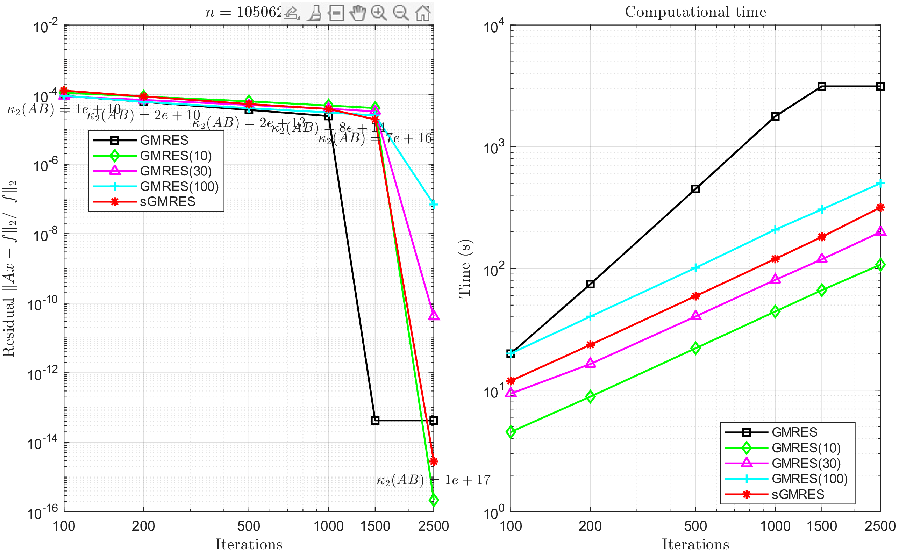
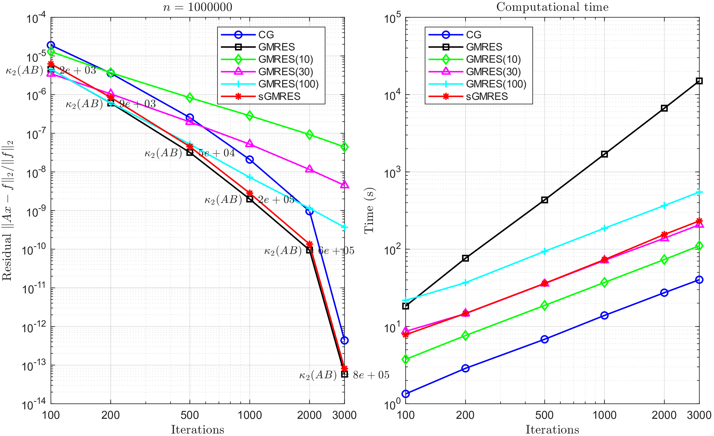
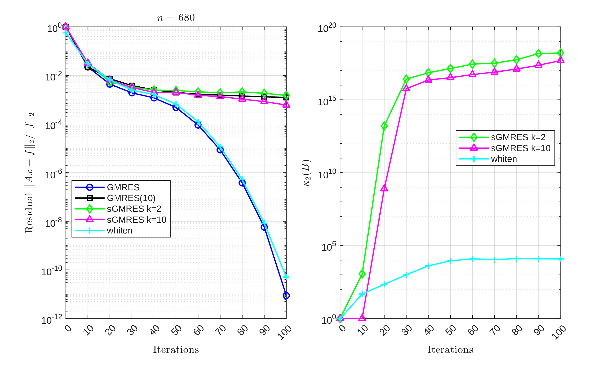

# Sketched GMRES: Reproducing NakTro24

This repository contains a MATLAB implementation that reproduces key figures from the paper *"Fast and Accurate Randomized Algorithms for Linear Systems and Eigenvalue Problems"* by Yuji Nakatsukasa and Joel A. Tropp. The full paper can be accessed via its DOI: [10.1137/23M1565413](https://doi.org/10.1137/23M1565413).

This project implements sketched GMRES (sGMRES), a method that accelerates standard subspace projection methods using fast randomized dimension reduction. It focuses strictly on the matrix-solving aspects of the paper. The goal of this project was to verify the results presented in the paper.

## Directory Structure & Contents

The codebase is split into two main directories to separate standard memory-efficient benchmarks from edge-case stability tests.

### `memory_efficient/`
Contains the primary experiments utilizing a highly storage-efficient implementation of the sGMRES algorithm. Standard GMRES stores the entire basis matrix in memory, which can easily crash machines on large problems. Our implementation solves this by using a circular buffer to store only the $k+1$ most recent basis vectors needed for truncated orthogonalization. It sketches the reduced matrix on the fly, solves the least-squares problem, and then regenerates the basis vectors a second time to construct the final solution vector. This trades CPU cycles for a massive reduction in RAM usage.
* **`nonsymmetric.m`**: Reproduces **Figure 1**, comparing GMRES and sGMRES ($k=4$) for a finite-element (FEM) discretization of a 2D convection-diffusion equation. 

* **`symmetric.m`**: Reproduces **Figure 3**, evaluating performance on a massive $10^6$-dimensional symmetric 2D Laplacian system and comparing sGMRES against standard GMRES and Conjugate Gradient (`pcg`). 

* **`sgmres.m`**: The core algorithmic engine implementing the memory-efficient sGMRES with $k$-truncated Arnoldi.

### `hard/`
Tackles challenging linear systems where standard sGMRES struggles due to rapid growth in the basis condition number.
* **`hard.m`**: Reproduces **Figure 4**, running a stress test on the notoriously difficult `fs_680_1` Matrix Market dataset to demonstrate a scenario where it is difficult to construct a numerically full-rank basis for the Krylov subspace. 

* **`sgmres.m`**: The baseline sketched GMRES engine using a Subsampled Randomized Fourier Transform (SRFT) and $k$-truncated Arnoldi.
* **`sgmres_whiten.m`**: Implements a safety-net stabilization technique. It actively monitors the condition number of the sketched basis; if it breaches a specific threshold (`tol = 10^3`), it triggers a "whitening" step that approximately orthogonalizes the basis to prevent the solver from failing.

## Implementation Notes & Deviations
While the scripts closely follow the methodology outlined by Nakatsukasa and Tropp, a few minor deviations were made. In instances where the paper omitted specific implementation details, this codebase adopts the closest mathematical approach intended by the authors. Mainly, we found a typographical error in the paper's Algorithm 1.1, Line 14. The paper incorrectly states the solution should be constructed using the columns of the reduced matrix: `x_hat = x + [m_1, ..., m_j] y_hat`. Our implementation correctly constructs the solution using the basis vectors, aligning with the mathematical definition `x_hat = x + B y_hat` established in Sections 3.2 and 3.3 of the text.
## Dependencies & Acknowledgments
This project relies on built-in MATLAB functions (such as `gmres`) and external software to generate test matrices:
1. **IFISS Software Package**: Used to generate the FEM discretization data for the nonsymmetric convection-diffusion case. It is only necessary to install if your desire it to generate nonsymmetric.mat independently. It can be obtained here: [https://personalpages.manchester.ac.uk/staff/david.silvester/ifiss/default.htm]. 
2. **`laplacian.m`**: Used to generate the Laplacian matrix for the symmetric linear system tests. This script is included in the `memory_efficient/` directory for convenience, but it was not developed by us. It was sourced from the MATLAB Central File Exchange ([https://www.mathworks.com/matlabcentral/fileexchange/27279-laplacian-in-1d-2d-or-3d]).

## Hardware Requirements
**Warning:** These scripts require substantial computational resources. The symmetric case, in particular, requires significant memory primarily due to the GMRES overhead. 
* **Minimum Recommended RAM:** 32 GB
* **Expected Runtime:** The scripts may take a considerable amount of time to execute completely, depending on your CPU.
